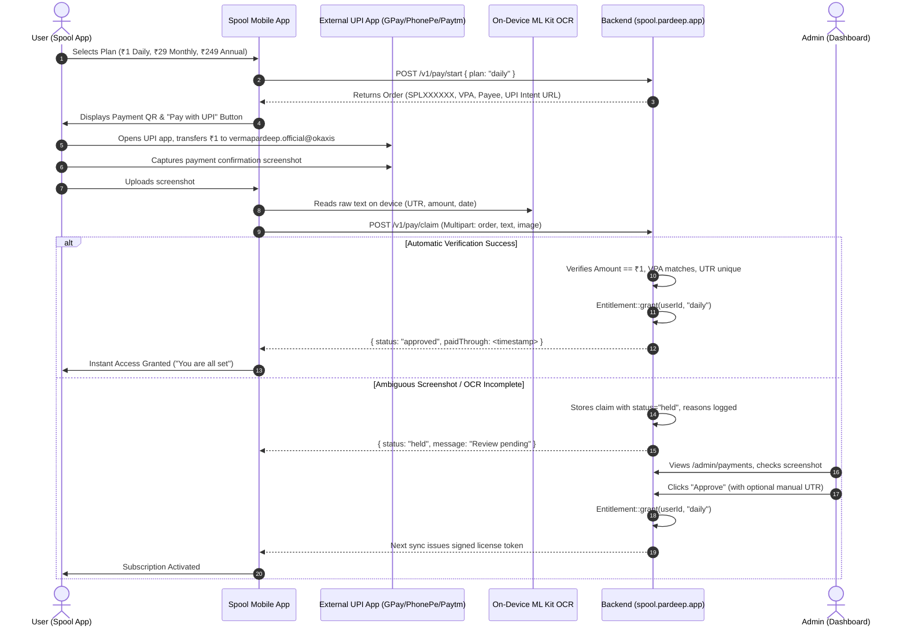
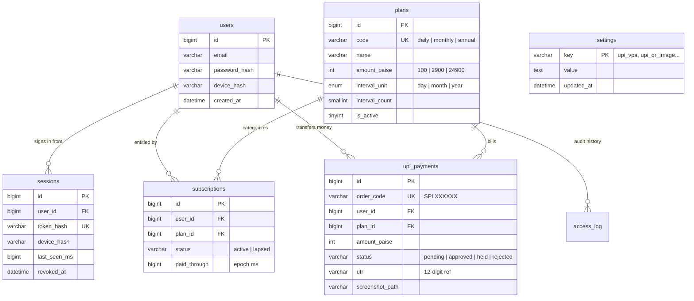

# Spool — Comprehensive System Documentation & Technical Blueprint

> **System**: Spool Media Player & Autonomous Downloader Ecosystem  
> **Client Platform**: Android (React Native 0.76+ / Expo Bare / Kotlin Native Module)  
> **Licence & Payment Authority**: Bespoke PHP 8.1+ / MySQL 8.0 Engine  
> **Production Domain**: `https://spool.pardeep.app`  
> **Build Artifacts**: `C:\ReactNative\Personal\Downloader\builds`  

---

## 1. Executive Summary & Core Philosophy

### What is Spool?
**Spool** is an elegant, privacy-first Android media ecosystem consisting of two deeply integrated components:
1. **The Android Client**: A high-performance media browser, offline library, background audio/video player, and local extraction suite powered by an embedded native `yt-dlp` runtime.
2. **The Licensing & Payment Server**: A zero-bloat PHP/MySQL authority running at `https://spool.pardeep.app` that coordinates accounts, issues cryptographically signed offline-capable license tokens (ECDSA P-256), and processes direct peer-to-peer UPI payments with client-side OCR verification.

### Core Product Philosophy
Unlike legacy downloaders (VidMate, TubeMate, Snaptube), Spool operates under strict product principles:
* **The Library is the Product**: Spool is not a download utility with a player bolted on; it is a full-fledged offline media player where downloading is simply the mechanism for acquiring personal media.
* **Extreme Privacy & Zero Telemetry**: The app has no tracking SDKs, no Google Analytics, no Facebook Pixel, and no ad networks. Only four domains are ever contacted:
  1. `m.youtube.com` (rendered in an isolated, sandboxed WebView).
  2. `i.ytimg.com` (caching cover art directly on disk).
  3. `lrclib.net` (lyrics retrieval — strictly opt-in upon user interaction).
  4. `spool.pardeep.app` (license verification and account sync).
* **Failure-Tolerant Playback**: Network drops, DNS hijacking, or complete server outages **never interrupt playback** of saved media. Offline permissions are verified locally using signed cryptographic tokens with dual-lease expiries.
* **Zero Middleman UPI Payments**: No Razorpay, Stripe, or payment gateway fees. Payments flow directly to the creator's UPI ID (`vermapardeep.official@okaxis`), and transaction confirmation is achieved through on-device machine-learning OCR (Google ML Kit) reading payment screenshots.

---

## 2. High-Level Architecture

The Spool ecosystem separates concerns cleanly across the client WebView shell, native Kotlin execution threads, and a transactional backend.

```mermaid
flowchart TD
    subgraph MobileClient["Spool Android Client (React Native + Kotlin)"]
        UI["React Native UI (Manrope typography, 5-Tab Shell)"]
        WV["Sandboxed WebView (m.youtube.com + Custom Injected JS)"]
        YTN["Native YtDlpModule (Kotlin + C/C++ binaries)"]
        EXP["ExoPlayer Native Audio/Video Service"]
        OCR["Google ML Kit Text Recognition Engine"]
        LG["LicenseGuard.kt (JCA / Android KeyStore Validation)"]
        STORE[("On-Device Storage: SQLite + AsyncStorage + MediaStore")]
    end

    subgraph LiveBackend["Spool Backend (spool.pardeep.app)"]
        APACHE["Apache Web Server (.htaccess / URL Rewrites)"]
        FC["Front Controller (public/index.php)"]
        AUTH["Services\\Accounts (Auth & Sessions)"]
        LIC["Services\\Licence (ECDSA P-256 Signing)"]
        PAY["Services\\Payments (Order Lifecycle & Verification)"]
        ENT["Services\\Entitlement (Time Leasing & Subscription)"]
        DB[("MySQL 8.0 InnoDB Database")]
        ADMIN["Admin Dashboard (/admin)"]
    end

    WV -->|PO Token / Video URL| UI
    UI -->|Extract / Download Request| YTN
    YTN -->|Write Audio/Video Streams| STORE
    STORE -->|Playback Streams| EXP
    UI -->|Receipt Screenshot| OCR
    OCR -->|UTR, Amount, Payee, Image| UI

    UI <-->|REST API (Bearer Token / JSON)| APACHE
    APACHE --> FC
    FC --> AUTH & LIC & PAY & ENT
    AUTH & LIC & PAY & ENT <--> DB
    ADMIN <--> DB
    LIC -.->|Signed ECDSA Token| LG
    LG -.->|Offline Permission Grant| UI
```

---

## 3. Client Capabilities & Feature Breakdown

### 3.1 The 5-Tab Shell
The main interface (`src/shell/TabBar.tsx`) is structured logically from local storage on the left, to the web in the middle, to user identity on the right:
1. **Home**: Quick resume for recent listens, smart recommendations computed locally based on listening history, and jump-back playlists.
2. **Search**: Instant dual search across both your local offline library and online YouTube queries without switching apps.
3. **Browse**: The core web engine. Runs both standard YouTube (`m.youtube.com`) and **YouTube Music** (`music.youtube.com`) inside a stripped-down `react-native-webview`. 
   - Segmented `[ YouTube | YT Music ]` header switcher for 1-tap toggling between regular video feeds and specialized music streaming.
   - On YouTube Music, instant downloads automatically prioritize pure high-quality Audio (Opus/M4A).
   - Uses a standard desktop Chrome User Agent so Google accounts and YouTube Music libraries function without webview blocks.
   - Injects custom JS (`NAV_SCRIPT`, `ADBLOCK_SCRIPT`, `POTOKEN_SCRIPT`).
   - Presents a clean, single Floating Action Button (FAB) that lights up when a downloadable media stream is detected.
4. **Library**: Your complete collection. Tracks, albums, artists, custom playlists, and automatic categorization between Audio and Video files.
5. **Profile**: Account management, active plan status, audio/video quality preferences, auto-save settings, and access to the subscription sheet.

### 3.2 Web Engine & Ad-Blocking Technology
The WebView in Browse tab features a multi-tiered script injection pipeline:
* **Three-Layer Ad-Blocker (`adblock.ts`)**:
  1. *CSS Element Hiding*: Injects styles suppressing `.ad-container`, `ytm-promoted-sparkles-web-renderer`, and banner overlays.
  2. *DOM Mutation Observer*: Monitors real-time player mutations to instantly silence, skip, or terminate pre-roll and mid-roll commercial streams.
  3. *Player API Interception*: Hooks into YouTube's HTML5 video element properties to bypass synthetic player pauses.
* **Single-Page Navigation Tracker (`youtube.ts`)**: Intercepts `window.history.pushState` and `window.history.replaceState` along with `yt-navigate-finish` events, maintaining continuous state sync without costly page refreshes.
* **PO-Token Harvester (`potoken.ts`)**: Continuously harvests Proof-of-Origin (PO) tokens generated by the YouTube client to ensure native `yt-dlp` requests bypass Google bot detection thresholds.

### 3.3 Media Extraction & Download Engine (`modules/ytdlp`)
The downloader is a custom Expo Native Module written in Kotlin:
* **Dual Client Chain**: Evaluates and routes download jobs through optimal YouTube clients (`ANDROID_VR`, `IOS`, `WEB`) to prevent throttling.
* **Extracted Formats**:
  * **Audio**: High-quality M4A (AAC) and MP3 with full ID3v2 tag embedding, cover art embedding, and artist resolution.
  * **Video**: MP4 streams up to 1080p, automatically muxing split video and audio streams using native FFmpeg.
* **Auto-Save Replays**: "Save what I replay" feature. When enabled, if a user listens to a track for more than 5 seconds across 3 distinct sessions, Spool quietly caches and tags the song into the offline library automatically.

### 3.4 High-Fidelity Player (`src/player`)
* **Dual-Engine Player Architecture**: Seamlessly controls local playback via ExoPlayer while synchronizing notification controls (`MediaSessionCompat`).
* **Background Playback**: Full background audio execution with lock screen album art, seek bar scrubbing, and headphone jack / Bluetooth AVRCP hardware controls.
* **Synchronized Lyrics (`useLyrics.ts`)**: Fetches synchronized `.lrc` timestamps from `lrclib.net` upon user request, displaying karaoke-style scrolling lyrics in sync with offline playback.

---

## 4. The Peer-to-Peer UPI Payment & Verification System

Spool replaces conventional gateway integrations with a seamless, zero-fee direct UPI verification flow.



### Key Components of Payment Flow:
1. **Dynamic Plans & Live Settings**:
   * The app calls `GET /v1/plans` at launch.
   * Plans (`daily` ₹1, `monthly` ₹29, `annual` ₹249) and payment credentials (`vpa`, `payee`, `qrImageUrl`) are fetched directly from the MySQL database, never hardcoded.
2. **On-Device OCR (`SubscribeSheet.tsx`)**:
   * Uses Google ML Kit to extract raw text from Google Pay, PhonePe, Paytm, or BHIM receipts on the phone before uploading.
   * Compresses the proof screenshot to an optimized 1600px JPEG to conserve mobile bandwidth.
3. **Server-Side Heuristic Engine (`UpiReceipt.php`)**:
   * Scans for 12-digit Indian Financial System Banking UTR numbers (`\b[0-9]{12}\b`).
   * Validates payee name match (`PARDEEP VERMA` / `pardeep`).
   * Validates transfer amount against exact expected paise (100 paise = ₹1.00).
   * Validates transaction timestamp within a strict time-slack window against Indian Standard Time (IST).

---

## 5. Cryptographic Licensing & Security Blueprint

Spool's licensing engine is designed to prevent piracy, avoid fake client replay attacks, and function 100% offline.

### 5.1 ECDSA P-256 Signature Verification
* **Algorithm**: ECDSA over NIST P-256 (`prime256v1`) with SHA-256.
* **Why P-256?**: Android's Java Cryptography Architecture (JCA) provides hardware-backed acceleration for P-256 on all devices back to API 11. Ed25519 requires Android 13+ (API 33), which would break compatibility for budget Android phones.
* **Token Structure**:
  $$\text{Token} = \text{base64url}(\text{Payload JSON}) \mathbin{\Vert} \text{"."} \mathbin{\Vert} \text{base64url}(\text{DER Signature})$$

### 5.2 Token Payload Spec
```json
{
  "v": 1,
  "dev": "9f8a3c8e2b1d4f6a8e0c...",
  "sub": "acct_8",
  "plan": "daily",
  "exp": 1792446946000,
  "iat": 1792360546000
}
```

### 5.3 The Dual-Lease Expiry Model
Token validity is governed by two time constants:
$$\text{Expiration} = \min(\text{paid\_through} + \text{GRACE\_MS}, \text{now} + \text{LEASE\_MS})$$
* **`GRACE_MS` (3 Days / 259,200,000 ms)**: If a renewal is made right before expiry or an admin manual review is delayed, the customer is never locked out.
* **`LEASE_MS` (3 Days / 259,200,000 ms)**: Bounds the offline token so an account revoked or refunded on the server will automatically lapse on the device within 72 hours even without an active internet connection.

### 5.4 Single-Stream Concurrency ("Play Lock")
To permit multi-device logins while preventing account sharing:
* Each playback session requests a short lease via `POST /v1/play/claim`.
* The server uses MySQL transactional row locks (`SELECT play_session_id, play_until FROM users FOR UPDATE`).
* If another device is playing, a `409 Conflict` is returned indicating the active device name (e.g., *"Playback in use on Samsung Galaxy S23"*), giving the user the option to take over the stream.

---

## 6. Database Schema & Data Models

The MySQL database (`spool` or `pardersk_spool`) uses 9 relational tables:



### Table Reference:
* **`plans`**: Contains purchasable tiers. Seeded with:
  * `daily`: ₹1 (100 paise) / 1 day
  * `monthly`: ₹29 (2900 paise) / 1 month
  * `annual`: ₹249 (24900 paise) / 1 year
* **`settings`**: Dynamic key-value store for live parameters:
  * `upi_vpa`: `vermapardeep.official@okaxis`
  * `upi_payee_name`: `PARDEEP VERMA`
  * `upi_qr_image`: `/paymentqrcode.jpeg`
  * `support_phone`: `919464263538`
* **`upi_payments`**: Immutable financial ledger of all orders and screenshot proof files.
* **`subscriptions`**: The entitlement record. `paid_through` in epoch ms determines customer status.

---

## 7. Backend API Specification

All API routes are served under `/v1` over TLS and respond strictly in JSON.

| Method | Endpoint | Auth Required | Description |
|---|---|---|---|
| `GET` | `/v1/plans` | No | Returns active plans list and live UPI payment settings (VPA, Payee, QR image URL). |
| `POST` | `/v1/auth/signup` | No | Registers user with email, password, and hardware `device_hash`. Returns Bearer token. |
| `POST` | `/v1/auth/login` | No | Authenticates user; binds new device session if within device limit. |
| `GET` | `/v1/licence` | Yes (Bearer) | Checks subscription status; issues cryptographically signed ECDSA offline license token. |
| `POST` | `/v1/pay/start` | Yes (Bearer) | Initializes an order (`plan: "daily"`). Returns `order_code`, UPI intent string, and VPA. |
| `POST` | `/v1/pay/claim` | Yes (Bearer) | Multipart submission of `order`, `text` (OCR body), and `image` (proof screenshot). |
| `POST` | `/v1/play/claim` | Yes (Bearer) | Claims the 2-minute single-stream playback lease for a given device. |
| `GET` | `/v1/health` | No | Checks database connectivity and system operational status. |

---

## 8. Admin Dashboard Guide

The administrative interface is accessed at `https://spool.pardeep.app/admin`.

### 8.1 Dashboard Home (`/admin`)
* Real-time metrics on Active Paid Subscribers, Monthly Recurring Revenue (MRR), and Today's collections.
* Quick overview of pending payments awaiting human attention.

### 8.2 Payment Reviews (`/admin/payments`)
* Displays all pending, held, approved, and rejected payments.
* Clicking any record opens the full payment review modal with the uploaded receipt screenshot.
* One-click **Approve**: Immediately grants the customer the selected plan period and credits `paid_through`.
* One-click **Reject**: Refuses fraudulent or unreadable screenshots with a custom note.
* One-click **Revoke**: Reverses previously granted subscription periods if a payment bounces or is disputed.

### 8.3 Live Plans & UPI Settings (`/admin/plans`)
* **Edit Plan Prices**: Change the rupee price for 1-Day, Monthly, or Annual passes anytime without restarting the server.
* **Toggle On-Sale**: Deactivate any tier with a single checkbox.
* **UPI VPA & Payee Name**: Update the receiving UPI address (`vermapardeep.official@okaxis`) or business name in real-time.
* **Upload Custom QR Code**: Upload a new QR image directly from the browser, which immediately reflects inside the mobile app.

---

## 9. Build, Testing & Deployment Operations

### 9.1 Android Client Build Artifacts
Pre-compiled release APKs configured to connect to `https://spool.pardeep.app` are located at:
* **Modern Devices (64-bit ARM)**: `C:\ReactNative\Personal\Downloader\builds\Spool-arm64-v8a-release.apk`
* **Older Devices (32-bit ARM)**: `C:\ReactNative\Personal\Downloader\builds\Spool-armeabi-v7a-release.apk`
* **PC Emulators (x86_64)**: `C:\ReactNative\Personal\Downloader\builds\Spool-x86_64-release.apk`

To compile fresh production APKs:
```bash
cd C:\ReactNative\Personal\Downloader\android
cmd.exe /c "gradlew assembleRelease"
```

### 9.2 Backend Server Deployment (`spool.pardeep.app`)
The complete deployment package is packaged at:
`C:\laragon\www\spool_production_deploy.zip`

**Deploying to cPanel / Production**:
1. Log into your hosting cPanel File Manager.
2. Navigate to the document root of `spool.pardeep.app`.
3. Upload `spool_production_deploy.zip` and extract all files.
4. Visit `https://spool.pardeep.app/seed_plans.php` once in your browser to seed the database with all plans and UPI credentials.
5. Verify live status:
   ```bash
   curl -i https://spool.pardeep.app/v1/plans
   ```

---

## 10. Summary Matrix

| Metric / Attribute | Value |
|---|---|
| **App Name** | Spool |
| **Target OS** | Android 7.0+ (API 24 to 35) |
| **Native Engine** | Kotlin + yt-dlp + ExoPlayer + ML Kit |
| **Licensing Protocol** | ECDSA P-256 with SHA-256 (JCA native) |
| **Payment Mechanism** | Direct Peer-to-Peer UPI |
| **Primary VPA** | `vermapardeep.official@okaxis` |
| **Payee Name** | PARDEEP VERMA |
| **Available Plans** | 1-Day (₹1) · Monthly (₹29) · Annual (₹249) |
| **Backend Stack** | PHP 8.1+ / MySQL 8.0 (No heavy framework) |
| **Server Endpoint** | `https://spool.pardeep.app` |
